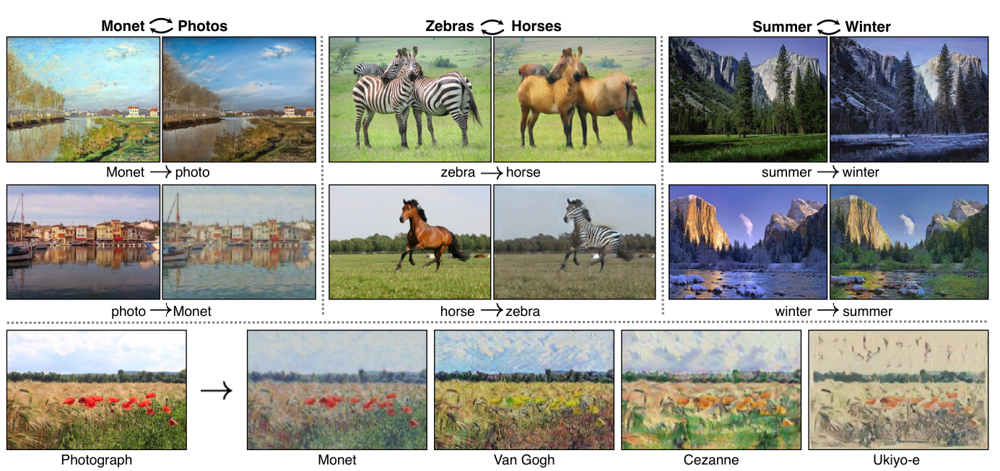
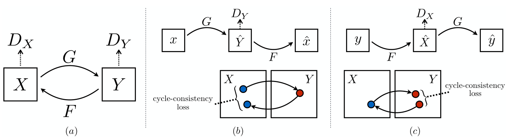
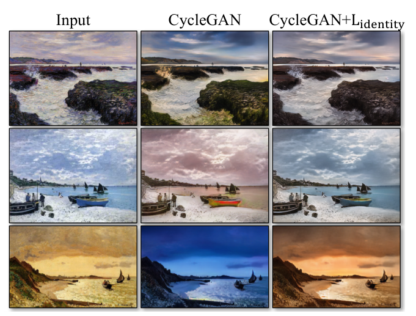
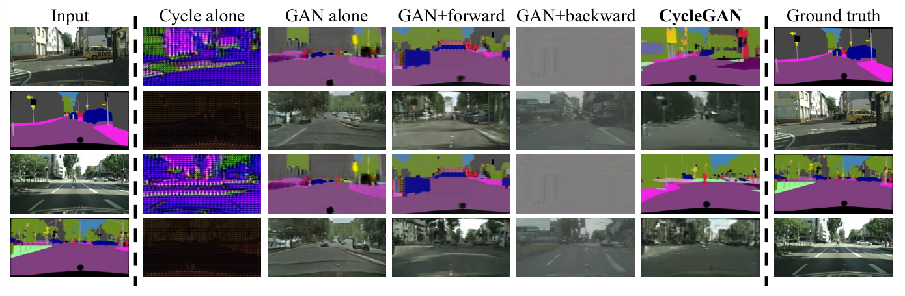
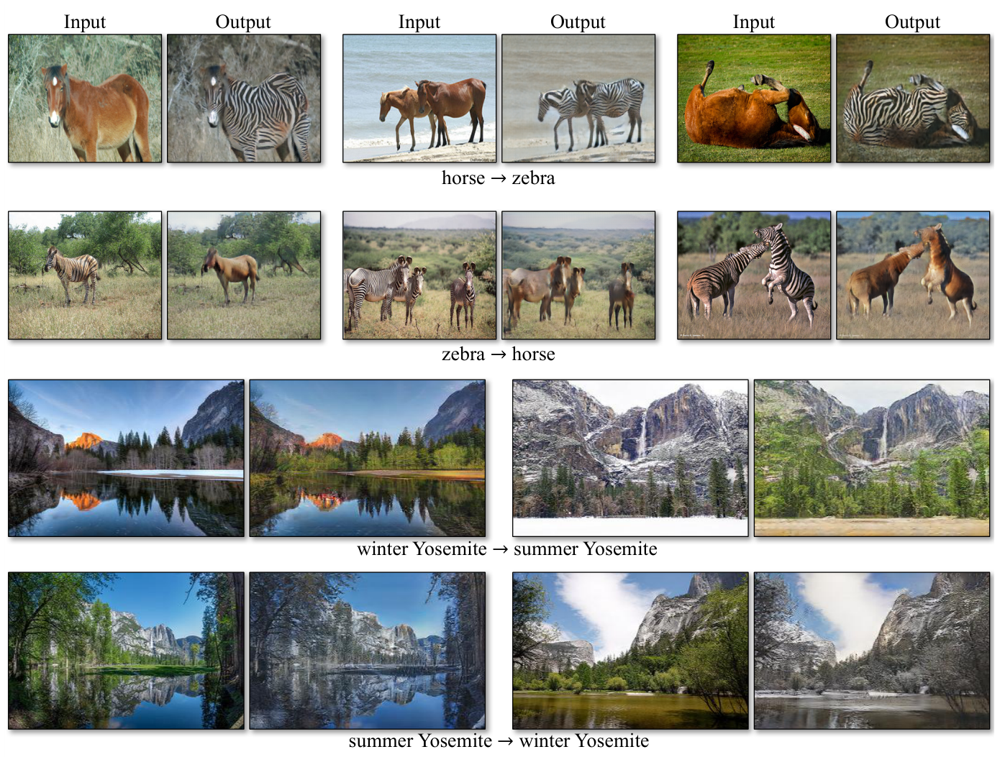

<!-- .slide: class="cover" -->
# Unpaired Image-to-Image Translation using Cycle-Consistent Adversarial Networks

以循環一致性對抗網路實現非成對影像轉換

報告人：○○○ ｜ 2026-11-16

---

<!-- .slide: class="info" -->
## 論文資訊

| | |
|---|---|
| 作者 | Jun-Yan Zhu\*, Taesung Park\*, Phillip Isola, Alexei A. Efros（\* 同等貢獻） |
| 單位 | Berkeley AI Research (BAIR) laboratory, UC Berkeley |
| 發表 | ICCV 2017（本報告依據 arXiv v7） |
| 連結 | [arXiv:1703.10593](https://arxiv.org/abs/1703.10593) |

Note:
今天要報告的是 CycleGAN，作者是 UC Berkeley BAIR 實驗室的 Jun-Yan Zhu 與 Taesung Park，兩位是同等貢獻，另外兩位作者是 Phillip Isola 與 Alexei Efros。這篇發表在 ICCV 2017，我讀的是 arXiv 第 7 版。值得一提的是，Isola 與 Efros 也是成對影像轉換方法 pix2pix 的作者，所以這篇可以看成是 pix2pix 往「不需要成對資料」方向的延伸。

---

## 報告大綱
1. 研究背景與動機
2. 研究方法與實驗設定
3. 實驗結果與討論
4. 結論

Note:
今天的報告分成四個部分。首先說明為什麼需要非成對的影像轉換，接著介紹 CycleGAN 的架構與損失函數，再來看量化實驗與消融實驗的結果，最後做總結。整份報告大約 30 分鐘，方法與結果會是重點。

---

<!-- .slide: class="section" -->

01

## 研究背景與動機

---

<!-- .slide: class="figure" -->
## CycleGAN 能在兩組沒有對應關係的影像集合間互相轉換

取自原文 Fig. 1

Note:
先看這張圖，了解這篇論文想做到什麼。左上是 Monet 的畫與風景照互轉，中間是斑馬與馬互轉，右邊是 Yosemite 的夏天與冬天互轉；下排則是把一張照片轉成 Monet、Van Gogh、Cezanne、浮世繪的風格。重點在於：這些任務都沒有「同一個場景的畫和照片」這種一對一的訓練資料，模型只看過兩堆各自獨立的影像。接下來就說明為什麼成對資料是個問題。

---

<!-- .slide: class="compare" -->
## 成對資料昂貴甚至不存在，本文只用兩組非成對影像

### 成對資料（過去的做法）
- 需要 $\{x_i, y_i\}$ 一對一對應
- 語意分割資料集少且規模小
- 藝術風格化需要藝術家親手創作
- 物件變形沒有明確的正確答案

### 非成對資料（本文）
- 只有來源集合 $X$ 與目標集合 $Y$
- 不知道哪張 $x_i$ 對應哪張 $y_j$
- 監督訊號只存在於「集合」層級

整理自原文 p.2 與 Fig. 2

Note:
影像轉換的定義是把同一個場景的一種表示轉成另一種，例如灰階轉彩色、標籤圖轉照片。過去強大的方法大多是監督式的，需要左邊這種一對一的成對資料。但作者指出成對資料很難取得：語意分割的資料集只有少數幾個而且規模小；藝術風格化要請藝術家創作；像斑馬變馬這種任務，連「正確答案」都沒有定義。所以本文改成右邊的設定：只給兩個領域各自的影像集合，不告訴模型誰對應誰。

---

## 只靠對抗損失，無法保證每張輸入對應到合理的輸出
- 對抗損失只讓 $G(X)$ 的分布接近 $Y$
- 有無限多種 $G$ 能產生相同的輸出分布
- 單獨訓練實務上常出現模式崩潰（mode collapse）
- 需要額外的結構限制來縮小可能的映射

Note:
既然沒有成對資料，最直覺的做法是用 GAN 的對抗損失，讓轉換後的影像跟目標領域分不出來。但作者指出兩個問題。第一，對抗損失只約束「整體分布」，有無限多種映射都能產生相同的分布，它不保證某一張輸入會對應到有意義的輸出。第二，實務上單獨最佳化對抗目標很困難，常出現模式崩潰，也就是所有輸入都被轉成同一張圖。所以需要額外的結構，這就是本文的切入點。

---

<!-- .slide: class="takeaway" -->
## 本文貢獻

同時學習 G 與 F 兩個方向的轉換，並以循環一致性損失要求「轉過去還能轉回來」

Note:
本文的核心貢獻是這一句話：同時訓練 X 到 Y 的 G 和 Y 到 X 的 F，加上循環一致性損失，讓 F(G(x)) 接近 x、G(F(y)) 接近 y，再和兩個方向的對抗損失合成完整目標。原文沒有條列式的貢獻清單，Introduction 另外提到：把方法用在集合風格轉換、物件變形、季節轉換、照片增強等多種任務；並和既有方法比較，作者宣稱表現優於這些 baseline；同時公開 PyTorch 與 Torch 程式碼。

---

<!-- .slide: class="compare" -->
## 循環一致性早有先例，本文把它用在影像轉換

### 既有用法
- 視覺追蹤：前向與後向的一致性檢查
- 語言翻譯：翻過去再翻回來（回譯）
- 用來監督 CNN 訓練 (Zhou et al., 2016)

### 本文做法
- 同時訓練 $G$ 與 $F$ 並要求互相一致
- 用 L1 重建誤差作為循環一致性損失
- 同期 DualGAN 也提出類似目標 (Yi et al., 2017)

整理自原文 Section 2（p.3）

Note:
循環一致性不是新概念。作者整理了它在視覺追蹤、語言翻譯上的長期使用，像是把英文翻成法文再翻回英文，應該要回到原句。近年也有研究用循環一致性損失來監督 CNN 訓練，作者認為 Zhou et al. 和 Godard et al. 跟本文最相近。本文的差別是把這個概念用在非成對影像轉換，要求 G 和 F 互相一致。另外要注意，同一屆 ICCV 的 DualGAN 也獨立提出了類似的目標，靈感來自機器翻譯的 dual learning。

---

<!-- .slide: class="table" -->
## CycleGAN 不需成對資料，也不需預先定義相似度

| 方法 | 訓練資料 | 如何維持輸入與輸出的關聯 |
|---|---|---|
| pix2pix (Isola et al., 2017) | 成對 | 條件式 GAN，直接以成對答案監督 |
| CoGAN (Liu & Tuzel, 2016) | 非成對 | 共享權重，學習兩領域的共同表示 |
| SimGAN (Shrivastava et al., 2017) | 非成對 | 預先定義的度量（像素空間距離） |
| Neural Style Transfer (Gatys et al., 2016) | 單張風格圖 | 預訓練特徵的 Gram matrix 統計 |
| **CycleGAN（本文）** | **非成對** | **循環一致性損失** |

整理自原文 Section 2（p.3–4）

Note:
這張表把本文和三類相關研究放在一起比較。pix2pix 是本文的基礎框架，效果好但需要成對資料。其他非成對方法如 CoGAN 用權重共享學習共同表示，SimGAN 等方法則在預先定義的度量空間裡要求輸出接近輸入，例如像素空間、類別標籤空間或特徵空間。神經風格轉換則是在兩張特定影像之間轉換風格。作者強調 CycleGAN 不依賴任務專用的相似度函數，也不假設兩個領域共用低維嵌入，因此是比較通用的解法。接下來進入方法。

---

<!-- .slide: class="section" -->

02

## 研究方法與實驗設定

---

<!-- .slide: class="figure" -->
## CycleGAN 用兩組生成器與判別器互相約束

- (a) $G$、$F$ 雙向轉換，$D_X$、$D_Y$ 各自判別真假
- (b) 前向循環：$x \to G(x) \to F(G(x)) \approx x$
- (c) 反向循環：$y \to F(y) \to G(F(y)) \approx y$

取自原文 Fig. 3

Note:
這是整篇論文最重要的一張圖。先看 (a)：有兩個生成器，G 把 X 轉成 Y，F 把 Y 轉回 X；兩個判別器中，D_Y 負責分辨真的 y 和 G 產生的假 y，D_X 則分辨真的 x 和 F 產生的假 x。(b) 是前向循環：x 經過 G 再經過 F，要回到原本的 x，兩者的差距就是循環一致性損失。(c) 則是反方向，從 y 出發。接下來三頁會把這張圖寫成公式。

---

<!-- .slide: class="equation" -->
## 對抗損失讓轉換結果與目標領域無法區分

$$
\begin{aligned}
\mathcal{L}_{GAN}(G, D_Y, X, Y) = \; & \mathbb{E}_{y \sim p_{data}(y)}[\log D_Y(y)] \\
+ \; & \mathbb{E}_{x \sim p_{data}(x)}[\log(1 - D_Y(G(x)))]
\end{aligned}
$$

- $D_Y$：分辨真實的 $y$ 與生成的 $G(x)$
- $G$ 最小化、$D_Y$ 最大化此目標
- $p_{data}$：真實資料的分布
- $F$ 與 $D_X$ 也使用相同形式的損失

原文 Eq. (1)

Note:
第一個元件是標準的 GAN 對抗損失。第一項希望判別器 D_Y 對真實的 y 給高分，第二項希望它對 G 產生的 G(x) 給低分；G 則反過來想騙過 D_Y。所以這是一個 min-max 問題：G 最小化、D_Y 最大化。反方向的 F 和 D_X 也有一模一樣形式的損失。不過如同前面說的，光有這個損失只能讓分布對齊，所以下一頁要加上循環一致性。

---

<!-- .slide: class="equation" -->
## 循環一致性損失要求轉換兩次後回到原圖

$$
\begin{aligned}
\mathcal{L}_{cyc}(G, F) = \; & \mathbb{E}_{x \sim p_{data}(x)}[\lVert F(G(x)) - x \rVert_1] \\
+ \; & \mathbb{E}_{y \sim p_{data}(y)}[\lVert G(F(y)) - y \rVert_1]
\end{aligned}
$$

- 第一項：前向循環 $x \to G(x) \to F(G(x))$
- 第二項：反向循環 $y \to F(y) \to G(F(y))$
- $\lVert\cdot\rVert_1$：L1 距離，衡量重建誤差
- 作者試過改用對抗損失，沒有觀察到改善

原文 Eq. (2)

Note:
循環一致性損失就是兩個重建誤差相加。第一項是前向循環：x 轉成 Y 再轉回來，要和原本的 x 越接近越好；第二項是反向循環，從 y 出發。距離用的是 L1。作者提到，在初步實驗中也試過把 L1 換成對抗損失，但沒有看到改善。直覺上，這個損失大幅縮小了可能的映射空間：G 不能隨便把輸入對應到任意一張目標影像，因為 F 必須能把它還原回來。

---

<!-- .slide: class="equation" -->
## 完整目標以 λ 平衡對抗損失與循環一致性損失

$$
\begin{aligned}
\mathcal{L}(G, F, D_X, D_Y) = \; & \mathcal{L}_{GAN}(G, D_Y, X, Y) \\
+ \; & \mathcal{L}_{GAN}(F, D_X, Y, X) + \lambda \mathcal{L}_{cyc}(G, F)
\end{aligned}
$$

$$
G^*, F^* = \arg\min_{G, F} \max_{D_X, D_Y} \mathcal{L}(G, F, D_X, D_Y)
$$

- $\lambda$：循環一致性損失的權重，實驗設為 10
- 可視為兩個以另一領域為中間表示的自編碼器

原文 Eq. (3)、Eq. (4)

Note:
把兩個方向的對抗損失加上乘以 λ 的循環一致性損失，就是完整目標，λ 控制兩者的相對重要性，所有實驗都設為 10。訓練時生成器 G、F 最小化這個目標，判別器 D_X、D_Y 最大化它。作者也提供一個觀點：F∘G 可以看成一個把 X 映射回 X 的自編碼器，只是它的中間表示剛好是 Y 領域的影像，而這個中間表示的分布由對抗損失約束。

---

<!-- .slide: class="figure" -->
## 恆等映射損失讓畫作轉照片時保留原本的顏色

- 只用於畫作→照片與照片增強，權重 $0.5\lambda$

取自原文 Fig. 9

Note:
除了主要的兩個損失，作者在畫作轉照片這類任務還加了一個恆等映射損失，作法參考 Taigman et al.：當輸入本來就是目標領域的影像時，要求生成器幾乎不要改變它，也就是 G(y) 接近 y、F(x) 接近 x。看這張圖中間那欄，沒有這個損失時，白天的畫常被轉成日落或夜晚的色調，因為這樣在對抗損失和循環損失下一樣成立；右欄加入後，就保留了原本的顏色。根據附錄，它的權重是 0.5λ。另外要注意，這張圖是訓練集上的結果。

---

## 生成器沿用 Johnson et al.，判別器採用 70×70 PatchGAN
- 生成器：卷積＋殘差區塊＋分數步幅卷積
- 128×128 用 6 個殘差區塊，256×256 以上用 9 個
- 使用實例正規化（instance normalization）
- 判別器：判斷每個 70×70 區塊的真假
- 區塊判別器參數少，可處理任意尺寸影像

Note:
實作上，生成器沿用 Johnson et al. 在風格轉換與超解析度上表現很好的架構：先用三個卷積，中間接數個殘差區塊，再用兩個 stride 二分之一的分數步幅卷積放大，最後一個卷積輸出 RGB。128 乘 128 的影像用 6 個殘差區塊，256 以上用 9 個，並使用實例正規化。判別器則用 pix2pix 中的 70×70 PatchGAN，不是判斷整張圖，而是判斷每個重疊的小區塊；這樣參數較少，而且可以全卷積地處理任意大小的影像。

---

## 以最小平方損失與影像緩衝區穩定訓練
- 以最小平方損失取代負對數概似 (Mao et al., 2017)
- 判別器用最近 50 張生成影像的緩衝區更新
- $\lambda = 10$，Adam，batch size 1
- learning rate 0.0002，100 epochs 後線性降到 0
- 所有網路從頭訓練，權重以 $\mathcal{N}(0, 0.02)$ 初始化

Note:
GAN 很難訓練，作者用了兩個技巧。第一，對抗損失改用 LSGAN 的最小平方形式，作者指出這樣訓練較穩定、結果品質較好。第二，參考 Shrivastava et al. 的做法，判別器不只看最新的生成結果，而是從一個存放最近 50 張生成影像的緩衝區取樣，用來減少模型震盪。其他設定：λ 等於 10、Adam、batch size 1、learning rate 0.0002，前 100 個 epoch 固定，之後 100 個 epoch 線性降到 0。附錄還提到最佳化判別器時把目標除以 2，讓判別器學得慢一點。

---

## 在 Cityscapes 與 Google Maps 上以人眼與 FCN 分數評估
- Cityscapes labels↔photo：2975 張，128×128
- Google Maps 地圖↔航照：1096 張，256×256
- AMT 真假測試：每個方法 25 位受試者
- FCN score：分割生成照片，與輸入標籤比對
- photo→labels：標準語意分割指標

Note:
量化評估沿用 pix2pix 的資料與指標，選的是「其實有成對答案」的資料集，這樣才能打分數。Cityscapes 用 2975 張訓練影像，解析度 128；Google Maps 的地圖與航照有 1096 張訓練影像，取自紐約市一帶。地圖任務用 Amazon Mechanical Turk 做真假測試：受試者看一張真的、一張生成的，選出哪張是真的，每個方法 25 人，每人 10 次練習加 40 次正式測試。Cityscapes 標籤轉照片則用 FCN score：拿現成的語意分割網路去分割生成的照片，看能不能分割回原本的標籤；反方向照片轉標籤則用 per-pixel accuracy、per-class accuracy 與 Class IOU。

---

<!-- .slide: class="table" -->
## 比較四種非成對 baseline，並以成對的 pix2pix 為上限

| 方法 | 做法 | 資料 |
|---|---|---|
| CoGAN (Liu & Tuzel, 2016) | 兩個生成器共享前幾層權重 | 非成對 |
| BiGAN/ALI (Donahue et al., 2017; Dumoulin et al., 2017) | 把 $z \to x$ 及其反向改成 $x \to y$ | 非成對 |
| SimGAN (Shrivastava et al., 2017) | 對抗損失＋像素 L1 正則化 | 非成對 |
| Feature loss + GAN | 改在 VGG-16 特徵上算 L1 | 非成對 |
| pix2pix (Isola et al., 2017) | 條件式 GAN（上限參考） | **成對** |

整理自原文 Section 5.1.2（p.6–7）

Note:
比較的 baseline 有五個。CoGAN 讓兩個領域的生成器共享前幾層權重；BiGAN 和 ALI 原本是學雜訊到影像以及反向的映射，作者把同樣的目標改成影像對影像；SimGAN 在對抗損失外加上輸入與輸出的像素 L1 正則化；Feature loss + GAN 則是把 L1 改到 VGG-16 的特徵空間計算。pix2pix 使用成對資料，作者把它當成「不用成對資料能逼近到多接近」的上限。為求公平，除了 CoGAN 用公開實作外，其他 baseline 都用和本文相同的架構與細節實作。

---

<!-- .slide: class="section" -->

03

## 實驗結果與討論

---

<!-- .slide: class="table" -->
## CycleGAN 騙過約四分之一的受試者，baseline 都低於 3%

| 方法 | Map → Photo | Photo → Map |
|---|---|---|
| CoGAN | 0.6% ± 0.5% | 0.9% ± 0.5% |
| BiGAN/ALI | 2.1% ± 1.0% | 1.9% ± 0.9% |
| SimGAN | 0.7% ± 0.5% | 2.6% ± 1.1% |
| Feature loss + GAN | 1.2% ± 0.6% | 0.3% ± 0.2% |
| **CycleGAN** | **26.8% ± 2.8%** | **23.2% ± 3.4%** |

整理自原文 Table 1（被受試者判為真實的比例，256×256）

Note:
先看人眼評估。表中數字是生成影像被受試者誤認為真實的比例，越高越好。CycleGAN 在地圖轉航照騙過 26.8% 的受試者，航照轉地圖是 23.2%，大約四分之一；所有 baseline 都不到 3%，幾乎騙不了人。作者另外在註腳提到 512 解析度的結果：地圖轉航照 CycleGAN 37.5%、pix2pix 33.9%。也要注意，作者提醒這些數字不能和 pix2pix 原論文直接比較，因為資料處理與受試者都不同。

---

<!-- .slide: class="table" -->
## CycleGAN 在 Cityscapes 雙向任務都優於 baseline，但仍落後 pix2pix

| 方法 | L→P Per-pixel | L→P Class IOU | P→L Per-pixel | P→L Class IOU |
|---|---|---|---|---|
| CoGAN | 0.40 | 0.06 | 0.45 | 0.08 |
| SimGAN | 0.20 | 0.04 | 0.47 | 0.07 |
| Feature loss + GAN | 0.06 | 0.01 | 0.50 | 0.06 |
| **CycleGAN** | **0.52** | **0.11** | **0.58** | **0.16** |
| pix2pix（成對） | 0.71 | 0.18 | 0.85 | 0.32 |

整理自原文 Table 2（L→P：labels→photo，FCN score）、Table 3（P→L：photo→labels）

Note:
這張表整理了 Cityscapes 上兩個方向的結果，L→P 是標籤轉照片、用 FCN score 評估，P→L 是照片轉標籤。兩個方向 CycleGAN 都是非成對方法中最好的，例如 L→P 的 per-pixel accuracy 是 0.52，最好的 baseline CoGAN 是 0.40。但和使用成對資料的 pix2pix 相比仍有明顯差距，P→L 的 Class IOU 只有 pix2pix 的一半。表中省略了 BiGAN/ALI 與 per-class accuracy，BiGAN/ALI 在 L→P 只有 0.19、P→L 是 0.41，完整數字在 brief 中。

---

<!-- .slide: class="table" -->
## 消融實驗：對抗損失與循環一致性損失缺一不可

| 設定 | L→P Per-pixel | L→P Class IOU | P→L Per-pixel | P→L Class IOU |
|---|---|---|---|---|
| Cycle alone | 0.22 | 0.02 | 0.10 | 0.02 |
| GAN alone | 0.51 | 0.08 | 0.53 | 0.07 |
| GAN + forward cycle | **0.55** | **0.12** | 0.49 | 0.07 |
| GAN + backward cycle | 0.39 | 0.06 | 0.01 | 0.01 |
| CycleGAN（完整） | 0.52 | 0.11 | **0.58** | **0.16** |

整理自原文 Table 4（labels→photo）、Table 5（photo→labels）

Note:
消融實驗把損失逐一拿掉。只用循環損失時分數最差；只用 GAN 損失在 P→L 的 Class IOU 從 0.16 掉到 0.07。作者據此結論：兩種損失都是關鍵。作者也測了只保留單一方向的循環，發現常造成訓練不穩定與模式崩潰，尤其是被拿掉的那個方向，例如只有 backward 時 P→L 幾乎完全失敗。不過要誠實指出，在 L→P 上 GAN 加 forward cycle 的分數其實略高於完整模型，原文沒有特別討論這點，完整模型的優勢主要表現在 P→L。

---

<!-- .slide: class="figure" -->
## 只用單一損失或單向循環，會產生錯誤領域或模式崩潰

- Cycle alone、GAN + backward：不像目標領域
- GAN alone、GAN + forward：輸出幾乎相同的標籤圖

取自原文 Fig. 7

Note:
這張圖是上一頁消融實驗的視覺化，第一、三列是照片轉標籤，第二、四列是標籤轉照片。可以看到 Cycle alone 和 GAN + backward 產生的影像根本不像目標領域，例如 GAN + backward 的標籤圖是一片灰。而 GAN alone 和 GAN + forward 在照片轉標籤時，第一列和第三列的輸出幾乎一模一樣，這就是模式崩潰：不管輸入哪張照片都輸出同一張標籤圖。只有完整的 CycleGAN 產生了和輸入對應的結果。

---

<!-- .slide: class="figure" -->
## 沒有成對資料的物件變形與季節轉換也能運作

節錄自原文 Fig. 13 上四列（作者註明為挑選過的較成功結果）

Note:
除了有標準答案的資料集，作者也展示了很多根本不存在成對資料的應用。這裡節錄 Fig. 13 的上四列：上面兩列是馬與斑馬互轉，用 ImageNet 的 939 張 wild horse 與 1177 張 zebra 訓練；下面兩列是 Yosemite 的冬夏互轉，用 Flickr 上的 854 張冬季與 1273 張夏季照片訓練。可以看到紋理和顏色的轉換相當自然。但要注意，作者明確寫這些是挑選過的相對成功結果。原文還有集合風格轉換、照片增強，以及和 Gatys et al. 神經風格轉換的比較，有興趣可以看原文 Fig. 10 到 Fig. 16。

---

## 討論與限制
- 作者指出：幾何變形（如狗→貓）幾乎失敗
- 作者指出：訓練資料沒有騎馬者，轉換就出錯
- 作者指出：與成對方法仍有差距，樹與建築會混淆
- 作者指出：照片增強的平均表現明顯較差
- 報告人觀點：量化只在兩個有成對答案的資料集

Note:
前四點都是作者自己承認的限制，可以對照原文 Fig. 17 的失敗案例。第一，顏色與紋理的轉換常成功，但需要幾何變形的任務幾乎不成功，像狗轉貓只做出很小的改變，作者推測是生成器架構偏向外觀變化。第二，horse 轉 zebra 遇到騎馬的人會出錯，因為 ImageNet 的訓練資料沒有騎乘的影像。第三，和成對方法仍有差距，照片轉標籤有時會把樹和建築的標籤互換，作者認為可能需要弱語意監督。第四，照片增強的圖只展示最成功的結果，作者說平均表現明顯較差。最後一點是報告人觀點：量化評估只做在 Cityscapes 與 Google Maps，多數應用只有挑選過的定性結果，而且消融中 GAN 加 forward 在 L→P 略優於完整模型。

---

<!-- .slide: class="todo" -->
## 個人評論

### 優點
- [待填寫]

### 缺點與疑問
- [待填寫]

### 可延伸的方向
- [待填寫]

Note:
[待填寫]

---

<!-- .slide: class="section" -->

04

## 結論

---

<!-- .slide: class="takeaway" -->
## 結論
1. 循環一致性讓非成對影像轉換變得可行
2. 量化結果明顯優於非成對 baseline，但仍落後 pix2pix
3. 擅長顏色與紋理變化，幾何變形仍是難題

Note:
總結三點。第一，CycleGAN 用「轉過去還要能轉回來」這個簡單的約束，讓只有兩堆非成對影像的情況下也能學到有意義的轉換。第二，在有標準答案的資料集上，它明顯優於其他非成對方法，但和使用成對資料的 pix2pix 仍有差距。第三，它擅長顏色與紋理的改變，需要改變形狀的任務仍是未來的挑戰。以上是我的報告，接下來開放提問。

---

<!-- .slide: class="qa" -->
# Q & A

謝謝聆聽

---

<!-- .slide: class="refs" -->
## 參考文獻
1. Zhu, J.-Y., et al. (2017). Unpaired image-to-image translation using cycle-consistent adversarial networks. *ICCV*.
2. Isola, P., Zhu, J.-Y., Zhou, T., & Efros, A. A. (2017). Image-to-image translation with conditional adversarial networks. *CVPR*.
3. Liu, M.-Y., & Tuzel, O. (2016). Coupled generative adversarial networks. *NIPS*.
4. Shrivastava, A., et al. (2017). Learning from simulated and unsupervised images through adversarial training. *CVPR*.
5. Donahue, J., Krähenbühl, P., & Darrell, T. (2017). Adversarial feature learning. *ICLR*.
6. Dumoulin, V., et al. (2017). Adversarially learned inference. *ICLR*.
7. Gatys, L. A., Ecker, A. S., & Bethge, M. (2016). Image style transfer using convolutional neural networks. *CVPR*.
8. Johnson, J., Alahi, A., & Fei-Fei, L. (2016). Perceptual losses for real-time style transfer and super-resolution. *ECCV*.
9. Mao, X., et al. (2017). Least squares generative adversarial networks. *CVPR*.
10. Taigman, Y., Polyak, A., & Wolf, L. (2017). Unsupervised cross-domain image generation. *ICLR*.
11. Zhou, T., et al. (2016). Learning dense correspondence via 3D-guided cycle consistency. *CVPR*.
12. Godard, C., et al. (2017). Unsupervised monocular depth estimation with left-right consistency. *CVPR*.
13. Yi, Z., et al. (2017). DualGAN: Unsupervised dual learning for image-to-image translation. *ICCV*.
