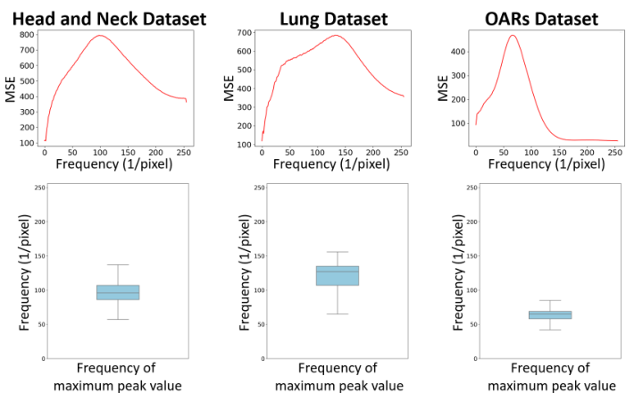
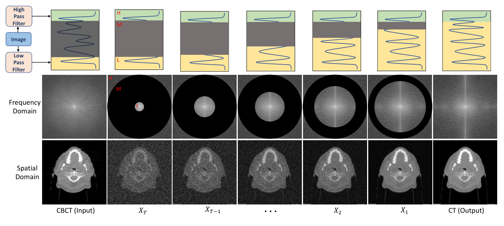
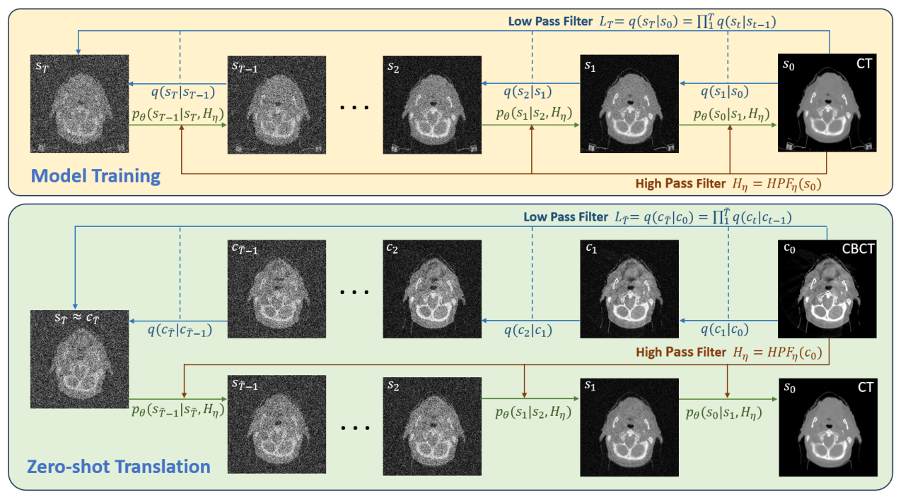
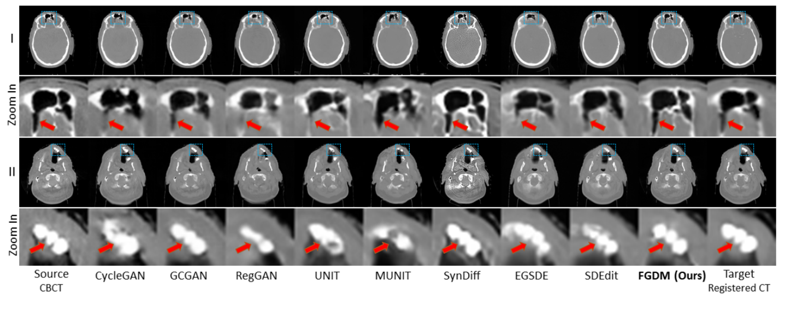

<!-- .slide: class="cover" -->
# Zero-shot Medical Image Translation via Frequency-Guided Diffusion Models

以頻率引導擴散模型實現零樣本醫學影像轉換

報告人：○○○ ｜ 2026-11-23

---

<!-- .slide: class="info" -->
## 論文資訊

| | |
|---|---|
| 作者 | Yunxiang Li, Hua-Chieh Shao, Xiao Liang, Liyuan Chen, Ruiqi Li, Steve Jiang, Jing Wang, You Zhang |
| 單位 | Medical Artificial Intelligence and Automation (MAIA) Lab, Dept. of Radiation Oncology, UT Southwestern Medical Center |
| 發表 | IEEE Transactions on Medical Imaging (TMI) 2024（本報告依據 arXiv v3） |
| 連結 | [arXiv:2304.02742](https://arxiv.org/abs/2304.02742) ｜ [程式碼](https://github.com/Kent0n-Li/FGDM) |

Note:
今天要報告的是 FGDM，全名是頻率引導擴散模型。作者群來自 UT Southwestern 醫學中心放射腫瘤科的 MAIA 實驗室，通訊作者是 You Zhang。這篇正式發表在 IEEE TMI，我讀的是 arXiv 第 3 版，頁碼都以這個版本為準。作者也公開了程式碼，連結在表格最後一列。

---

## 報告大綱
1. 研究背景與動機
2. 研究方法與實驗設定
3. 實驗結果與討論
4. 結論

Note:
今天的報告分成四個部分。首先說明為什麼醫學影像轉換需要保留結構，以及作者在頻率域上的關鍵觀察；接著介紹 FGDM 如何用高、低頻濾波器引導擴散模型；然後看四個資料集的比較與消融實驗；最後做總結。方法與結果會是重點。

---

<!-- .slide: class="section" -->

01

## 研究背景與動機

---

## CBCT 轉 CT 是放療的關鍵需求，轉換不能改變解剖結構
- CBCT 在直線加速器上取得，影像品質較差
- 需轉成類 CT 影像才能精確計算劑量
- 用途：去噪、劑量計算、治療計畫調整
- 轉換錯誤可能扭曲、位移甚至移除腫瘤
- 進而導致誤診或治療不當

Note:
先介紹應用情境。錐狀射束電腦斷層（Cone-Beam CT，CBCT）是放射治療時在直線加速器上拍的影像，受限於硬體與掃描方式，品質比一般的 CT 差，所以常要把它轉成像 CT 的影像，才能準確計算劑量。作者強調，醫學影像轉換和自然影像不同，最重要的是解剖結構不能變；如果轉換時把腫瘤扭曲、移位甚至抹掉，就可能造成誤診或治療不當。接下來看現有的擴散模型為什麼做不好這件事。

---

<!-- .slide: class="compare" -->
## 擴散模型直接轉換會遺失結構，以成對影像為條件又難取得資料

### 直接對來源影像加噪再去噪
- 自然影像（如貓轉狗）已有成功案例
- 前向擴散會遺失結構細節
- 反向去噪無法完全補回

### 以來源影像為條件 (Lyu & Wang, 2022)
- 需要解剖一致的成對影像
- 受解剖移動、成本、輻射劑量限制
- 帶入領域特有資訊，分布外較不穩健

整理自原文 Section I（p.1–2）

Note:
擴散模型（Diffusion Model）生成的影像品質很好，用在影像轉換有兩種常見做法。左邊是直接對來源影像加噪、再用目標領域學到的反向擴散去噪；這在貓轉狗這類只需保留姿勢、顏色的任務很成功，但前向擴散會把結構細節洗掉，去噪時補不回來。右邊是把來源影像當條件、用成對資料訓練，可以保留結構，但醫學上成對且解剖一致的影像很難取得；作者也指出，來源影像本身會帶入領域特有的資訊，遇到不同部位或掃描協定時反而不穩健。那有沒有辦法只保留「該保留的資訊」？下一頁是作者的關鍵觀察。

---

<!-- .slide: class="figure" -->
## CBCT 與 CT 的差異主要集中在中頻

取自原文 Fig. 2

Note:
作者把成對的 CBCT 和 CT 轉到頻率域，計算每個頻率振幅的均方誤差（MSE）。上排是三個資料集的平均 MSE 曲線，可以看到兩端低、中間高；下排的盒狀圖是每組資料 MSE 峰值落在哪個頻率，集中在中間的頻帶。也就是說，CBCT 和 CT 在低頻（整體強度、語意）和高頻（解剖輪廓）上差不多，主要差在中頻。這個觀察就是整篇方法的出發點。

---

<!-- .slide: class="takeaway" -->
## 本文貢獻

用來源影像的高、低頻當條件，讓只看過目標領域的擴散模型補上中頻，實現零樣本轉換

Note:
本文的核心貢獻就是這一句話。作者列了三點：第一，提出 FGDM，用低頻與高頻資訊引導中頻訊號的生成，保留解剖結構；第二，設計高通與低通濾波器擷取領域不變的資訊，而且兩個門檻在測試階段可以自由調整；第三，在 CBCT 轉 CT 任務上優於 GAN、VAE 和擴散模型類的方法。作者也宣稱這是第一個在解剖層級用擴散模型做零樣本醫學影像轉換的研究。這裡的零樣本（Zero-shot）是指訓練時完全沒看過 CBCT。

---

<!-- .slide: class="compare" -->
## GAN 與 VAE 方法都需要兩領域資料，且分別有訓練不穩與影像模糊的問題

### GAN 類
- CycleGAN (Zhu et al., 2017)：循環一致性
- GCGAN (Fu et al., 2019)：幾何一致性
- RegGAN (Kong et al., 2021)：加對位網路
- 兩網路互相對抗，訓練困難且不穩定

### VAE 類
- UNIT (Liu et al., 2017)：共享潛在空間
- MUNIT (Huang et al., 2018)：內容碼＋風格碼
- 生成的影像常有模糊問題
- 兩類方法訓練都需兩個領域的影像

整理自原文 Section II-A（p.3–4）、p.8

Note:
接下來是相關研究，也是後面實驗的比較對象。生成對抗網路（GAN）類以 CycleGAN 最具代表性，用循環一致性損失約束兩個方向的轉換；GCGAN 改用幾何轉換的一致性，RegGAN 則加入對位網路處理沒對齊的資料。作者認為 GAN 由兩個網路對抗訓練，本質上訓練困難且不穩定。變分自編碼器（VAE）類的 UNIT 假設兩領域共享潛在空間，MUNIT 再把內容和風格拆開，但產生的影像常常模糊。這兩類方法的共同點是：訓練時都需要來源和目標兩個領域的影像。

---

<!-- .slide: class="compare" -->
## 既有擴散方法真實度高，但忠實度不足或仍需來源領域資料

### SDEdit 與 EGSDE（自然影像）
- SDEdit (Meng et al., 2021)：加噪後去噪
- EGSDE (Zhao et al., 2022)：能量函數引導
- 影像逼真，但前向擴散丟失結構

### SynDiff（醫學影像）
- (Özbey et al., 2023)
- 對抗式擴散＋循環一致性結構
- 依賴 CycleGAN 的轉換結果來訓練
- 訓練需要來源與目標兩個領域

整理自原文 Section II-B（p.4）、p.10

Note:
擴散模型類方法中，SDEdit 先對來源影像加噪，再用隨機微分方程（SDE）去噪；EGSDE 則用預訓練的能量函數引導，保留領域無關的特徵。作者指出這類方法影像很逼真，但前向擴散會丟失解剖細節，所以忠實度不足。醫學影像上的 SynDiff 結合對抗式擴散與循環一致性，但它依賴 CycleGAN 的結果來訓練，效能也會受 CycleGAN 限制，而且同樣需要兩個領域的資料。FGDM 的定位就是：保留擴散模型的真實度，同時提高忠實度，而且只用目標領域訓練。

---

<!-- .slide: class="section" -->

02

## 研究方法與實驗設定

---

<!-- .slide: class="figure" -->
## FGDM 保留 CBCT 的高低頻，只用反向擴散補上中頻

取自原文 Fig. 3

Note:
這張圖是整體概念。最左邊的 CBCT 經過高通濾波器（High-pass Filter）和低通濾波器（Low-pass Filter），得到高頻 H 和低頻 L，中間的 M 是要生成的中頻。看中排的頻率域：一開始只有中心的低頻和外圈的高頻，中間是黑的；隨著反向擴散一步步進行，中間的頻帶逐漸被填滿，最後得到右邊的 CT。下排是對應的空間域影像，從雜訊很多慢慢變清楚。下一頁看訓練和推論的具體差別。

---

<!-- .slide: class="figure" -->
## 訓練只看 CT，轉換時改用 CBCT 的高低頻當條件

取自原文 Fig. 4

Note:
上半部黃色是訓練：只用 CT，從 s0 一路加噪到第 T 步，每一步去噪都以 CT 自己的高頻資訊 H_η 當條件，學會「給定高頻和部分低頻，補出中頻」。下半部綠色是零樣本轉換：把 CBCT 只加噪到第 T̃ 步，T̃ 小於等於 T，這就等於保留了 CBCT 的低頻；再用 CBCT 的高頻當條件，一步步去噪得到 CT。作者說訓練用較大的 T，是為了讓模型能處理各種低頻門檻；原文沒寫 T 的實際數值，[待確認]。接下來說明為什麼加噪等於低通濾波。

---

<!-- .slide: class="equation" -->
## 加噪時高頻的訊雜比先下降，前向擴散就是低通濾波

$$
s_t=\sqrt{\alpha_t}\,s_0+\sqrt{1-\alpha_t}\,z,\quad z\sim\mathcal{N}(0,\sigma^2)
$$

$$
SNR_t=\frac{\sqrt{\alpha_t}\,k}{\sqrt{1-\alpha_t}\,\lVert(u,v)\rVert^{a}\sigma^2}\quad(k>0,\ a>1)
$$

- $\alpha_t$：隨 $t$ 遞減；$z$：高斯白雜訊
- $\lVert(u,v)\rVert$：空間頻率；$k$、$a$：影像頻譜參數
- 頻率越高 SNR 越低，加噪到 $\tilde{T}$ 步只剩低頻

原文 Eq. (6)、Eq. (19)

Note:
第一條是擴散模型的前向過程：第 t 步的影像是原圖乘上根號 α_t，加上雜訊；α_t 隨 t 遞減，所以越後面雜訊越多。關鍵在第二條：白雜訊在所有頻率的功率都一樣，但一般影像的功率頻譜密度（PSD）隨頻率遞減，所以訊雜比（SNR）在高頻比較低，高頻會先被雜訊淹沒。作者據此推論，存在某個步數 T̃，讓高於門檻的頻率全部被淹沒，這時前向擴散就等同一個低通濾波器，也就是原文 Eq. (22)。低頻有了，高頻用另一個濾波器取得。

---

<!-- .slide: class="equation" -->
## 高通濾波以 Sobel 梯度強度加上門檻 η

$$
i_{mag}=\sqrt{G_x^2+G_y^2},\qquad G_x=K_x\circledast i,\ \ G_y=K_y\circledast i
$$

$$
H_\eta(x,y)=\begin{cases} i_{mag}(x,y) & i_{mag}(x,y)\ge\eta\\ 0 & i_{mag}(x,y)<\eta\end{cases}
$$

- $K_x$、$K_y$：Sobel 核；$i_{mag}$：梯度強度
- $\eta$：門檻，越大濾掉的資訊越多

原文 Eq. (23)–(25)

Note:
高頻部分作者用的是 Sobel 運算子（Sobel Operator）。先用水平和垂直兩個 Sobel 核對影像做卷積，得到兩個方向的梯度，再算出梯度強度；邊緣和解剖輪廓的地方梯度強度大。接著設一個門檻 η，低於門檻的直接設成 0，只留下夠強的邊緣，這就是高頻條件 H_η。η 是可以在測試時調整的參數，太小會連 CBCT 的偽影一起保留，太大則結構資訊不夠，後面參數分析會看到。

---

## 以 denoising diffusion GAN 為骨幹，8 步內完成取樣
- 骨幹：denoising diffusion GAN (Xiao et al., 2022)
- 每一步去噪都以高頻 $H_\eta$ 為條件
- 以隨時間步變化的判別器做對抗訓練
- 原始 DDPM 需 1000 步以上，本文不到 8 步
- 單張轉換約 0.2 秒，SDEdit 約 9 秒

Note:
骨幹網路作者選的是 denoising diffusion GAN，它用 GAN 來建模每一步的去噪分布，判別器會隨時間步變化。好處是速度：原始的去噪擴散機率模型（DDPM）(Ho et al., 2020) 取樣要一千步以上，這個骨幹不到 8 步就能完成，作者說表現接近 DDPM、速度快數百倍。實驗中 FGDM 轉一張影像約 0.2 秒，SDEdit 約 9 秒。作者選這個骨幹是考慮到線上自適應放療很重視轉換速度。

---

<!-- .slide: class="equation" -->
## 零樣本轉換：CBCT 加噪到 T̃ 步，再以其高頻為條件去噪

$$
q(s_{\tilde{T}}\mid c_0)=\mathcal{N}\!\left(s_{\tilde{T}};\sqrt{\alpha_{\tilde{T}}}\,c_0,\,(1-\alpha_{\tilde{T}})\sigma^2\right)
$$

$$
p_\theta(s_0\mid s_t)=\prod_{t=1}^{\tilde{T}}p_\theta\!\left(s_{t-1}\mid s_t,\,HPF_\eta(c_0)\right)
$$

- $c_0$：來源 CBCT；$\tilde{T}\le T$：轉換時的加噪步數
- 第一式：加噪到 $\tilde{T}$ 步，等於保留低頻
- 第二式：以 CBCT 高頻為條件去噪 $\tilde{T}$ 步

原文 Eq. (29)–(30)、Algorithm 1

Note:
把前面兩個濾波器組合起來，就是零樣本轉換的流程。第一式是對來源 CBCT c0 做前向擴散到第 T̃ 步，也就是低通濾波，保留 CBCT 的低頻。第二式是從這裡開始反向去噪 T̃ 步，每一步都以 CBCT 經高通濾波後的 H_η 當條件，模型就負責補出 CT 風格的中頻。整個過程模型只在 CT 上訓練過，沒有看過任何 CBCT，所以是零樣本。下一頁進入實驗設定。

---

<!-- .slide: class="table" -->
## 以頭頸部訓練，再直接套用到肺部與 OARs 測試零樣本能力

| 資料集 | 人數 | 用途 |
|---|---|---|
| 頭頸部 CBCT／CT | 訓練 70／驗證 9／測試 20 | 訓練與分布內測試 |
| 肺部 CBCT／CT | 18 | 分布外測試（換部位） |
| OARs CBCT／CT | 24 | 分布外測試（背景差異大） |
| 頭部 MR T1 | NFBS 125／ABCs 60 | 跨中心轉換 |

整理自原文 Section IV-A（p.7）

Note:
實驗用了四個資料集。頭頸部是主要資料集，分成訓練 70、驗證 9、測試 20 例。肺部和危及器官（Organs at Risk，OARs）兩個資料集完全不拿來訓練，直接套用頭頸部訓練出來的模型，用來測試分布外的表現；OARs 來自 AAPM 的胸腔自動分割挑戰，影像不像頭頸部那樣被黑色背景包圍，分布差異更大。最後是兩個中心的頭部 MR T1 影像，模擬跨機構的影像調和；原文對 FGDM 在這組用哪個中心訓練的敘述前後不一致，[待確認]。CT 影像都截在 -1000 到 1000 HU，切片縮放到 192 × 192。

---

## 以 FID 衡量真實度，以 PSNR 與 SSIM 衡量忠實度
- 真實度：與參考 CT 比較 FID
- 忠實度：與來源 CBCT 及參考 CT 比較 PSNR、SSIM
- 參考 CT 由可變形對位得到，並非真正答案
- 比較 GAN、VAE、擴散類共 8 種方法
- 訓練時 η 隨機取 1–25；測試用 η=10、T̃=4

Note:
評估分兩個面向。真實度（Realism）看轉換結果像不像 CT，用 FID。忠實度（Faithfulness）看結構有沒有保留，用 PSNR 和 SSIM，而且同時和來源 CBCT、參考 CT 比較，因為參考 CT 是用可變形對位對齊到 CBCT 的，本身有對位誤差，不是真正的標準答案。另外也算了頻率域的 MSE。實作上用 Adam、初始學習率 10 的 -4 次方、batch size 8、訓練 200 epochs，在一張 V100 上跑；訓練時 η 隨機取 1 到 25，讓模型適應不同的高頻門檻。

---

<!-- .slide: class="section" -->

03

## 實驗結果與討論

---

<!-- .slide: class="table" -->
## 頭頸部資料集上 FGDM 所有指標皆最佳

| 方法 | FID ↓ | PSNR（來源）↑ | SSIM（來源）↑ | PSNR（目標）↑ | SSIM（目標）↑ |
|---|---|---|---|---|---|
| CycleGAN | 47.6 | 22.5 | 0.844 | 22.6 | 0.867 |
| GCGAN | 42.3 | 23.6 | 0.863 | 23.7 | 0.886 |
| UNIT | 36.6 | 22.2 | 0.821 | 22.8 | 0.854 |
| SynDiff | 49.0 | 26.0 | 0.902 | 22.9 | 0.862 |
| SDEdit | 33.2 | 24.8 | 0.830 | 25.0 | 0.857 |
| **FGDM** | **24.0** | **27.8** | **0.908** | **26.4** | **0.904** |

整理自原文 Table I

Note:
先看分布內的頭頸部結果。FID 越低越好，其他越高越好。FGDM 的 FID 是 24.0，次佳是 SDEdit 的 33.2，可見擴散模型在真實度上的優勢；同時 FGDM 的 PSNR、SSIM 也都最高。值得注意的是 SynDiff 與來源的 SSIM 有 0.902，排第二，但 FID 是 49.0，在原文全部方法中最差，代表忠實但不夠像 CT。表中省略了 RegGAN、MUNIT、EGSDE 三列以及頻域 MSE 欄，FGDM 在原表全部 9 種方法、所有欄位都最佳，頻域 MSE 是 400。

---

<!-- .slide: class="figure" -->
## 放大鼻腔與牙齒，可見其他方法遺失或扭曲結構

- 最左為來源 CBCT，最右為對位後的參考 CT

取自原文 Fig. 5

Note:
這是頭頸部的視覺比較，第 I 組放大鼻腔，第 II 組放大牙齒，紅色箭頭是要看的位置。作者指出 SDEdit 和 EGSDE 整體看起來還可以，但放大後鼻腔和牙齒的結構明顯遺失或扭曲；UNIT、MUNIT 這類 VAE 方法也保留得不好；GCGAN 在真實度和忠實度間比較平衡。FGDM 的細節最接近來源影像，但作者也承認仍有少量細小結構對不上。接下來看分布外的資料。

---

<!-- .slide: class="table" -->
## 換部位、換中心後多數方法明顯退步，FGDM 仍是最佳

| 方法 | 肺部 | OARs | 頭部 MR |
|---|---|---|---|
| CycleGAN | 62.5 / 0.838 | 118.0 / 0.554 | 86.4 / 0.664 |
| GCGAN | 59.6 / 0.876 | 142.0 / 0.724 | 61.2 / 0.706 |
| SynDiff | 60.8 / 0.872 | 184.0 / 0.589 | 104.0 / 0.693 |
| EGSDE | 101.0 / 0.799 | 198.0 / 0.816 | 69.1 / 0.687 |
| SDEdit | 81.5 / 0.826 | 191.0 / 0.79 | 61.5 / 0.656 |
| **FGDM** | **42.4** / **0.906** | **94.8** / **0.857** | **59.3** / **0.805** |

整理自原文 Table II、Table III、Table IV（數值為 FID ↓ / 與來源的 SSIM ↑）

Note:
這張表合併了三個資料集，每格左邊是 FID、右邊是與來源的 SSIM。和頭頸部比，多數方法在肺部的 FID 明顯變差，例如 SDEdit 從 33.2 變成 81.5，EGSDE 超過 100；OARs 因為背景差異大，所有方法 FID 都很高，但 FGDM 仍是唯一低於 100 的。頭部 MR 是跨中心的任務，FGDM 的 FID 和 SSIM 也都最佳。作者說明其他方法換分布後會出現結構遺失和幻覺結構。表中省略 RegGAN、UNIT、MUNIT 三列和其他指標欄，FGDM 在原表的全部欄位都最佳。

---

<!-- .slide: class="table" -->
## 消融實驗：移除高頻引導時 SSIM 下降最多

| 設定 | FID ↓ | PSNR（來源）↑ | SSIM（來源）↑ | PSNR（目標）↑ | SSIM（目標）↑ |
|---|---|---|---|---|---|
| 無低頻引導 | 30.2 | 24.3 | 0.89 | 23.8 | 0.889 |
| 無高頻引導 | 38.2 | 21.5 | 0.748 | 21.8 | 0.778 |
| **FGDM（完整）** | **24.0** | **27.8** | **0.908** | **26.4** | **0.904** |

整理自原文 Table V

Note:
消融實驗（Ablation Study）在頭頸部資料上分別拿掉低頻或高頻引導。兩者拿掉任何一個，所有指標都變差，代表兩個條件缺一不可。其中拿掉高頻影響最大，與來源的 SSIM 從 0.908 掉到 0.748，與目標的 SSIM 掉到 0.778，這呼應作者的想法：解剖輪廓主要藏在高頻。拿掉低頻時 FID 從 24.0 變成 30.2，影像的整體強度比較不像 CT。

---

<!-- .slide: class="table" -->
## 調整 η 與 T̃ 可在測試時取捨忠實度與真實度

| 設定 | FID&nbsp;↓ | PSNR&nbsp;↑ （來源） | SSIM&nbsp;↑ （來源） | PSNR&nbsp;↑ （目標） | SSIM&nbsp;↑ （目標） |
|---|---|---|---|---|---|
| η=5 | 26.9 | 26.7 | 0.892 | 25.5 | 0.881 |
| η=25 | 34.6 | 26.4 | 0.869 | 25.9 | 0.88 |
| T̃=1 | 26.1 | **30.2** | **0.922** | **26.4** | 0.903 |
| T̃=5 | 26.7 | 27.2 | 0.888 | 25.8 | 0.881 |
| **η=10、T̃=4（採用）** | **24.0** | 27.8 | 0.908 | **26.4** | **0.904** |

整理自原文 Table VI、Table VII

Note:
這兩個參數都是在測試時直接調整，不用重新訓練。η 太小，高頻裡混入 CBCT 的偽影；η 太大，高頻引導不足、結構保留變差，η 等於 10 最好。T̃ 越小，保留越多 CBCT 的低頻，所以和來源的 PSNR、SSIM 最高，T̃ 等於 1 時 SSIM 有 0.922，但條狀偽影也被保留；T̃ 等於 5 時強度又偏離 CT。作者取 T̃ 等於 4 平衡兩者。表中省略 η 為 15、20 與 T̃ 為 2、3 的列；原文 p.12 對 T̃ 變小時 FID 與目標指標變化的文字描述和表格不一致，[待確認]，這裡以表格數字為準。報告人觀點：η 等於 10 那列和 T̃ 等於 4 那列數字完全相同，推測調一個參數時另一個固定在預設值。

---

## 討論與限制
- 作者指出：只適用相近模態或跨中心的轉換
- 作者指出：MR→CT 等高低頻差異大的任務可能不佳
- 作者指出：未最佳化模型結構與損失函數
- 報告人觀點：與來源比的分數偏好「少轉換」
- 報告人觀點：η、T̃ 是在測試集上挑選

Note:
前三點是作者自己承認的限制。FGDM 的前提是兩個領域的低頻和高頻相近，所以只適用 CBCT 和 CT 這種相近模態，或是同模態不同中心、機器、協定的情況；MR 轉 CT 這種高低頻差異很大的任務可能不行，作者打算未來先轉換高低頻資訊再補中頻。作者也說只設計了框架，沒有針對模型結構或損失函數最佳化，以 DDPM 為骨幹是否更準也留待未來。後兩點是我的觀點：和來源 CBCT 比較的 PSNR、SSIM，在 T̃ 等於 1 時最高，等於是越不轉換分數越高；另外 η 和 T̃ 是看測試集結果挑的，數字可能偏樂觀。

---

<!-- .slide: class="todo" -->
## 個人評論

### 優點
- [待填寫]

### 缺點與疑問
- [待填寫]

### 可延伸的方向
- [待填寫]

Note:
[待填寫]

---

<!-- .slide: class="section" -->

04

## 結論

---

<!-- .slide: class="takeaway" -->
## 結論
1. CBCT 與 CT 的差異集中在中頻，高低頻可沿用
2. 只用目標領域訓練，就能零樣本轉換並保留結構
3. 濾波門檻可在測試時調整，不需重新訓練

Note:
最後總結三點。第一，作者從頻率域觀察到 CBCT 和 CT 主要差在中頻，所以可以直接沿用來源影像的高頻和低頻當條件。第二，FGDM 只用 CT 訓練，就能把沒看過的 CBCT 轉成 CT，並在四個資料集上都優於比較的方法，換到肺部、OARs 也一樣穩定。第三，兩個濾波門檻可以在測試時調整，不用重新訓練，但前提是任務的差異確實集中在中頻。以上是我的報告，謝謝。

---

<!-- .slide: class="qa" -->
# Q & A

謝謝聆聽

---

<!-- .slide: class="refs" -->
## 參考文獻
1. Li, Y., et al. (2024). Zero-shot medical image translation via frequency-guided diffusion models. *IEEE TMI*.
2. Zhu, J.-Y., et al. (2017). Unpaired image-to-image translation using cycle-consistent adversarial networks. *ICCV*.
3. Fu, H., et al. (2019). Geometry-consistent generative adversarial networks for one-sided unsupervised domain mapping. *CVPR*.
4. Kong, L., et al. (2021). Breaking the dilemma of medical image-to-image translation. *NeurIPS*.
5. Liu, M.-Y., et al. (2017). Unsupervised image-to-image translation networks. *NeurIPS*.
6. Huang, X., et al. (2018). Multimodal unsupervised image-to-image translation. *ECCV*.
7. Meng, C., et al. (2021). SDEdit: Image synthesis and editing with stochastic differential equations. *arXiv*.
8. Zhao, M., et al. (2022). EGSDE: Unpaired image-to-image translation via energy-guided stochastic differential equations. *arXiv*.
9. Özbey, M., et al. (2023). Unsupervised medical image translation with adversarial diffusion models. *IEEE TMI*.
10. Lyu, Q., & Wang, G. (2022). Conversion between CT and MRI images using diffusion and score-matching models. *arXiv*.
11. Ho, J., et al. (2020). Denoising diffusion probabilistic models. *NeurIPS*.
12. Xiao, Z., et al. (2022). Tackling the generative learning trilemma with denoising diffusion GANs. *ICLR*.
