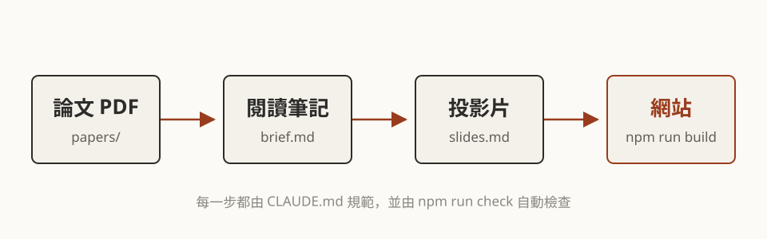

<!-- .slide: class="cover" -->
# Slide Types Showcase

論文報告投影片庫：12 種頁面類型示範

templates/slide-types.md ｜ 依照 CLAUDE.md §6

---

<!-- .slide: class="info" -->
## 論文資訊

| | |
|---|---|
| 類型 | `info`：論文書目資訊，每份只有一頁 |
| 作者 | 依照原文順序列出 |
| 發表 | 期刊或會議簡稱＋年份 |
| 連結 | 優先使用 arXiv 或 DOI |

Note:
info 頁固定用兩欄表格呈現書目資訊。

---

## 報告大綱
1. 研究背景與動機
2. 研究方法
3. 實驗結果
4. 結論與討論

Note:
沒有指定類型的頁面，預設就是 bullets。

---

<!-- .slide: class="section" -->

01

## 章節分隔頁

---

## 標題寫結論，而不是寫主題
- 每頁只講一個重點
- 條列最多 5 點，每點不超過一行
- 寫不下就拆成兩頁，不要縮小字級
- 專有名詞第一次出現寫成「中文（English）」

Note:
這是 bullets 類型。左上角的章節名稱會依照前一個 section 頁自動帶入。

---

<!-- .slide: class="figure" -->
## 一篇論文經過四個階段變成網站

自繪示意圖

Note:
figure 類型：一頁一張主圖，下方一定要有來源行。

---

<!-- .slide: class="table" -->
## 12 種頁面類型各有固定用途

| 類型 | 用途 | 類型 | 用途 |
|---|---|---|---|
| `cover` | 封面 | `table` | 表格 |
| `info` | 書目資訊 | `equation` | 公式 |
| `section` | 章節分隔 | `compare` | 左右比較 |
| `bullets` | 條列（預設） | `takeaway` | **重點結論** |
| `figure` | 單張圖 | `todo` / `qa` / `refs` | 評論／問答／文獻 |

整理自 CLAUDE.md §6

Note:
table 類型：重點用粗體，會顯示為赤陶色。

---

<!-- .slide: class="equation" -->
## 報告頁數由報告時間決定

$$
N_{\text{slides}} \approx \frac{T_{\text{talk}}}{t_{\text{per slide}}} = \frac{30\ \text{min}}{1\ \text{min}} \approx 30
$$

- $T_{\text{talk}}$：報告時間（本專案預設 30 分鐘）
- $t_{\text{per slide}}$：每頁平均講解時間（約 1 分鐘）

CLAUDE.md §5

Note:
equation 類型：一頁最多兩條公式，每個符號都要解釋。

---

<!-- .slide: class="compare" -->
## 結論式標題讓聽眾一眼抓到重點

### ❌ 主題式
- 模型架構
- 實驗結果

### ✅ 結論式
- 模型用兩組生成器互相約束
- 新方法的分數接近有監督方法

Note:
compare 類型：左欄放既有方法或反例，右欄放本文方法或正例。

---

<!-- .slide: class="takeaway" -->
## 重點結論

規範寫清楚，AI 就能照同一套方式，一直做下去

Note:
takeaway 類型：用在貢獻與結論，一頁只放一句話或三點以內。

---

<!-- .slide: class="todo" -->
## 個人評論

### 優點
- [待填寫]

### 缺點與疑問
- [待填寫]

### 可延伸的方向
- [待填寫]

Note:
todo 類型：AI 只建立版面，內容留給報告人自己填寫。

---

<!-- .slide: class="qa" -->
# Q & A

謝謝聆聽

---

<!-- .slide: class="refs" -->
## 參考文獻
1. reveal.js — The HTML presentation framework. https://revealjs.com
2. 本專案規範：CLAUDE.md §6 頁面類型、§7 內容撰寫原則
